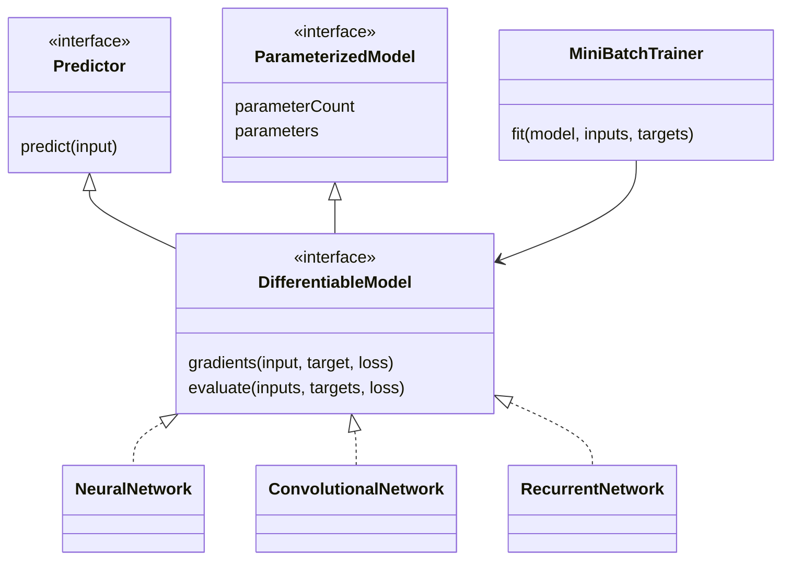
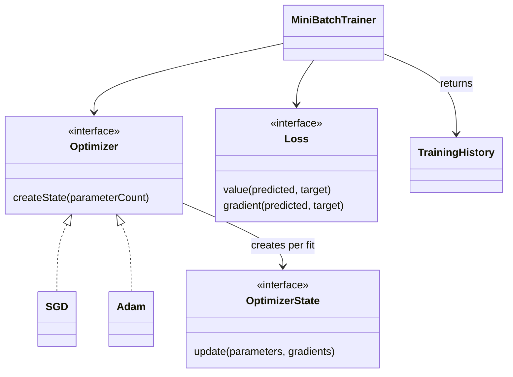
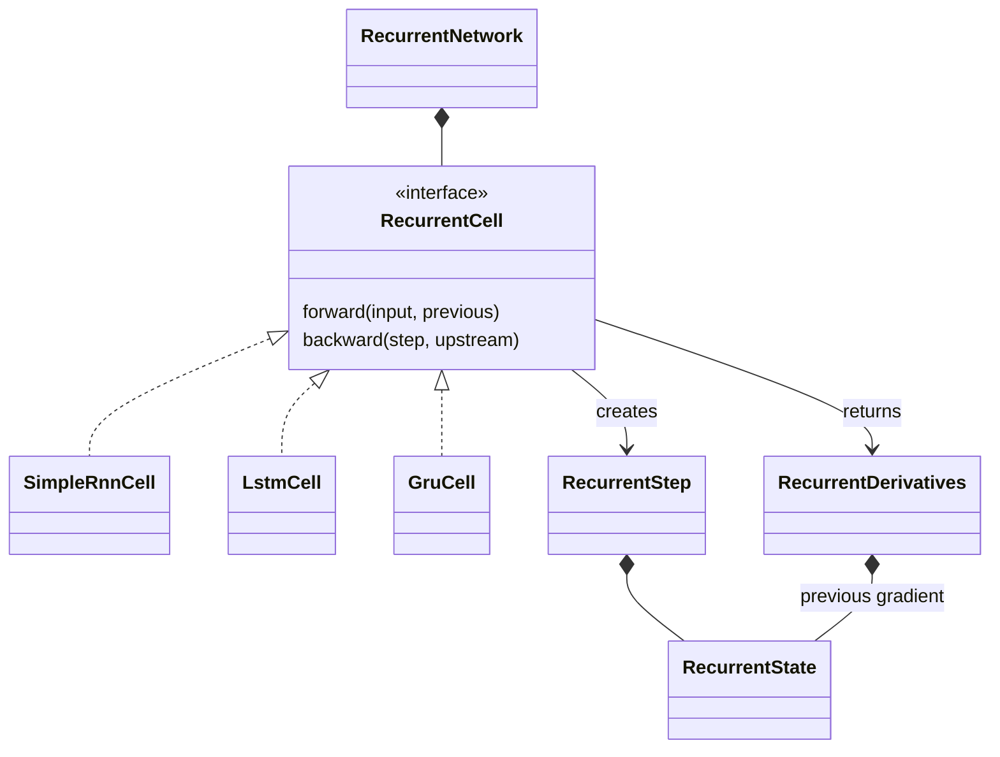
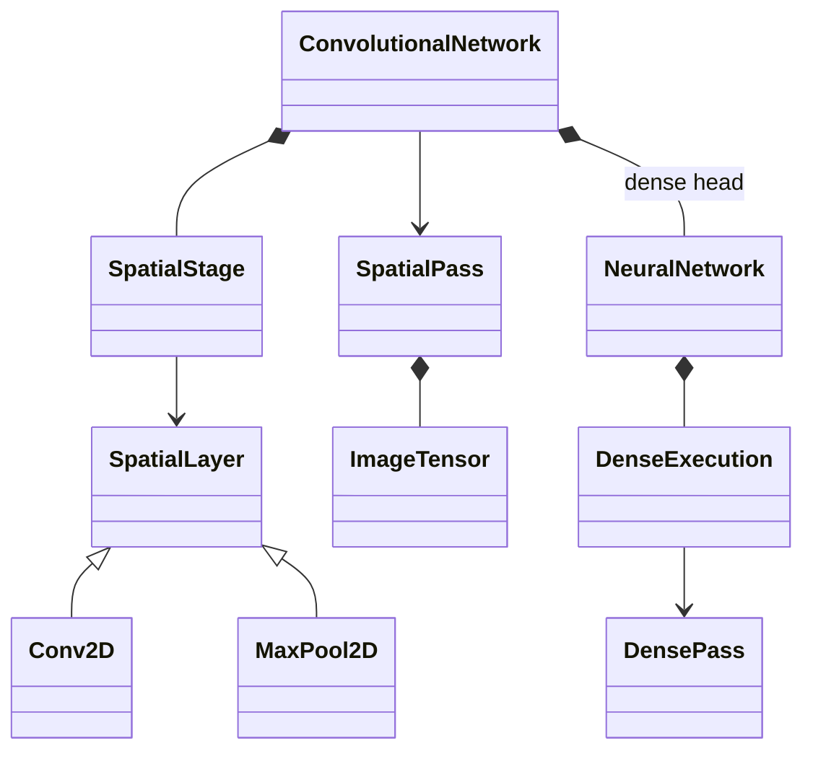
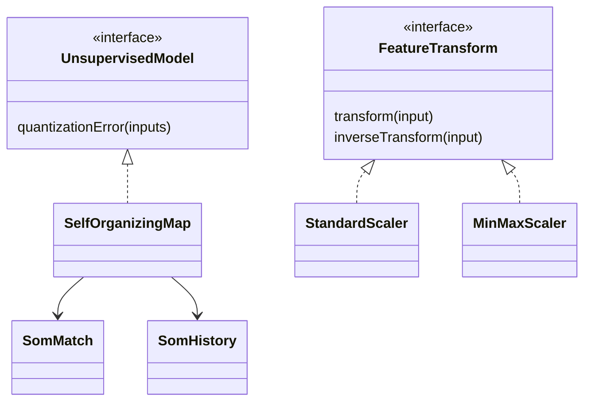
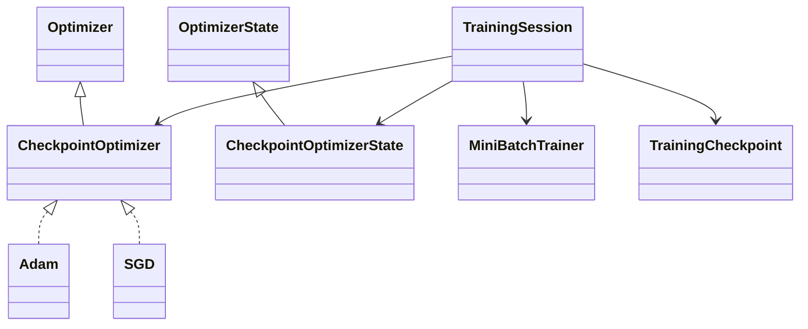

# Class diagrams / Diagramas de classes

These diagrams show implemented relationships, split by concern. Public exports
are listed in `lib/neural_engine.dart`; executor/cache classes are internal.

## Models and trainer

## Training collaborators

## Recurrent transition and session state

## Spatial and dense composition

## Unsupervised model and preprocessing

Class names refer to Dart types. Free numerical functions `spatialForward` and
`spatialBackward` are intentionally described in the structure/training documents,
not invented as classes in this diagram. SOM is not a DifferentiableModel.

## Optional persistence contracts

A custom plain Optimizer remains usable without implementing checkpoint support.
TrainingSession.restore accepts explicit application-owned model/optimizer decoders.
