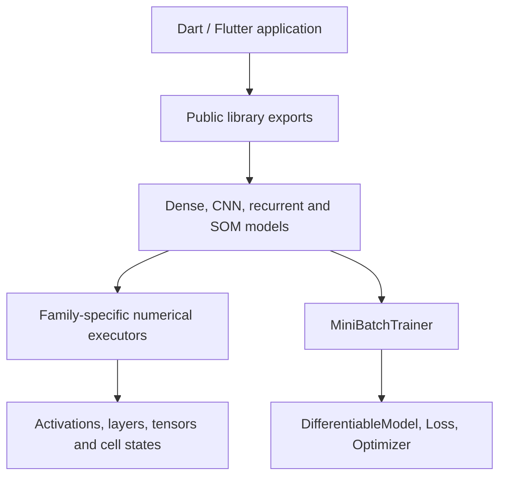

# Architectural overview / Visão geral

## Goals and boundaries

`neural_engine` is a pure Dart numerical library. Applications choose scheduling,
IO and UI. The core has no Flutter, HTTP, GPU, other engine or file-system
runtime dependency. Model families keep distinct mathematics but use common
contracts and a common supervised training lifecycle.

SOM is deliberately outside the supervised trainer: it has competitive learning,
a Gaussian neighborhood and quantization metrics, rather than a target loss and
a gradient optimizer. Autoencoder is a dense architecture with reconstruction
targets, not another special-purpose training framework.

## Decisions

| Decision | Reason / consequence |
| --- | --- |
| Facades implement contracts | The trainer does not identify model runtime types |
| One shared supervised trainer | Validation, early stopping and clipping behave consistently across Dense, CNN and recurrent models |
| Numerical passes separate from facades | Dense and spatial forward/backward code can be inspected without lifecycle/JSON/UI code |
| One public class per responsibility/file | Interfaces, layer specs, states, metrics and optimizers have discoverable locations; a private session/cache can remain with its owner |
| Immutable outputs and snapshots | Callers cannot corrupt parameters through returned lists |
| Mutable model parameters | Training intentionally changes weights; concurrent use requires separate model instances |
| Recurrent state belongs to a sequence | Independent predictions always start from zeros; no hidden cross-request memory |
| Flat parameter contract | Optimizers work on vectors; numerical differentiation can inspect every coordinate |
| Versioned family-specific JSON | Inference models can be moved without IO in the core; optimizer state is not a checkpoint |
| No universal graph/autodiff engine | Explicit derivations keep small CPU models and educational explanations inspectable |

## Regras de extensão

Para acrescentar um modelo supervisionado, implemente `DifferentiableModel<I>`:
previsão, snapshot de parâmetros, gradiente de uma amostra e avaliação de um lote.
Use `MiniBatchTrainer<I>` para treinamento. Não copie a rotina de épocas para o
modelo novo. Para um otimizador, implemente `Optimizer` e `OptimizerState`; o
estado deve ser criado novamente a cada chamada de treinamento.

Uma nova célula recorrente implementa `RecurrentCell`, retornando estado/cache
por passo e derivadas para o passo anterior. Os caches não são globais nem
reutilizados entre sequências. As células integradas são selecionadas por
`RecurrentKind`; uma integração customizada pode compor a célula diretamente.
A seleção/serialização do modelo integrado aceita apenas famílias conhecidas.

`SpatialLayer` descreve as duas especificações suportadas. Uma implementação
externa dessa classe não ganha execução ou serialização automática: é necessário
acrescentar explicitamente suporte ao executor espacial e ao codec da CNN.

Cada feature exige teste público, documentação em inglês/português e, para uma
família nova, exemplo Dart e demonstração Flutter. Para alterações numéricas,
verifique derivadas por diferenças finitas e comportamento no limite.

## Asynchronous execution

See [async training](../async_training.md). Numerical batch updates are shared,
while platform scheduling/transport and serializable worker codecs are separated
under `training/async/`. The session remains model-agnostic. A result checkpoint
commits a complete epoch; cancellation never represents partial work as complete.
