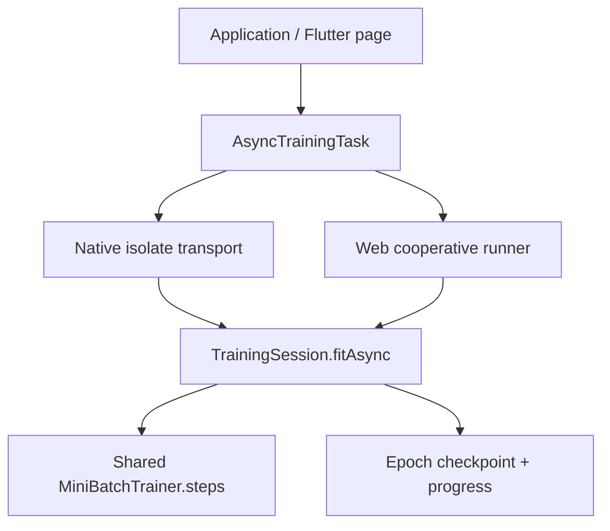

# Asynchronous training (0.3.0)

The asynchronous API is introduced in 0.3.0. The core still has no Flutter or
runtime package dependency.

## Choose an execution mode

| API | Native Dart / Flutter | Web | Extension support |
| --- | --- | --- | --- |
| `AsyncTrainingTask.start(request)` | Dedicated isolate | Cooperative batches | Built-in MLP, CNN, RNN, LSTM, GRU; Adam/SGD; MSE/BCE/CCE |
| `TrainingExecution.cooperative` | Current isolate, yielding between batches | Browser event loop | Same portable request codecs |
| `TrainingExecution.isolate` | Dedicated isolate | Throws UnsupportedError | Same portable request codecs |
| `TrainingSession<I>.fitAsync(...)` | Current isolate, yielding between batches | Browser event loop | Custom DifferentiableModel + JsonModel, Loss and CheckpointOptimizer |

Autoencoders use the dense model. SOM is unsupervised and retains its independent
fit/decay schedule; it is not silently converted into a supervised session.

`automatic` resolves to `isolate` on native and `cooperative` on web. The task's
`execution` getter reports the resolved mode. An isolate receives a copied,
JSON-compatible checkpoint and dataset, not a closure capturing Flutter State.
Creating the request copies/encodes data on the caller; avoid very large UI-side
snapshots. Returned checkpoints are independent of the original model.

## Start, observe, cancel and resume

```dart
final session = TrainingSession<List<double>>(
  model: NeuralNetwork(inputSize: 2, seed: 42, layers: [
    Dense(8, activation: Activation.tanh),
    Dense(1, activation: Activation.sigmoid),
  ]),
  optimizer: Adam(learningRate: 0.02),
  seed: 42,
);
final inputs = <List<double>>[[0, 0], [0, 1], [1, 0], [1, 1]];
final targets = <List<double>>[[0], [1], [1], [0]];
AsyncTrainingRequest request(TrainingCheckpoint checkpoint, int epochs) =>
    AsyncTrainingRequest(
      checkpoint: checkpoint, inputs: inputs, targets: targets,
      loss: TrainingLoss.binaryCrossEntropy, epochs: epochs, batchSize: 2,
    );
final task = AsyncTrainingTask.start(request(session.checkpoint(), 100));
final subscription = task.progress.listen((p) {
  print('${p.epochsCompleted}: ${p.loss} (${p.elapsed})');
  if (p.epochsThisRun >= 20) task.cancel();
});
final result = await task.result;
await subscription.cancel();
// result.cancelled means training stopped before the requested epoch count.
// task.cancel() is idempotent and never force-kills a partially updated epoch.
final remaining = 100 - result.checkpoint.epochsCompleted;
if (remaining > 0) {
  final resumed = await AsyncTrainingTask.start(
    request(result.checkpoint, remaining),
  ).result;
  final restored = NeuralNetwork.fromJson(resumed.checkpoint.model);
  print(restored.predict([0, 1]));
}
```

Run the complete checked example with `dart run example/async_training.dart`.
Use `jsonEncode(result.checkpoint.toJson())` to save and
`TrainingCheckpoint.fromJson(jsonDecode(text) as Map<String, dynamic>)` to load.
IO belongs to the application. The checkpoint is the existing version-1 format.

## Progress and cancellation semantics

- One `TrainingProgress` is emitted per committed epoch, in order. It contains
  absolute `epochsCompleted`, this run's `epochsThisRun`, `requestedEpochs`, loss,
  optional validation loss and elapsed training duration. `fraction` is per run.
- Validation requires both `validationInputs` and `validationTargets`. Session
  training is fixed-epoch: validation is reported, not used for early stopping.
  This avoids restoring best weights with optimizer moments from another epoch.
- Cancelling finishes the current epoch, then returns its checkpoint. An isolate
  message may arrive after another epoch starts. Never assume an exact stopping
  epoch from a UI click; use `result.checkpoint.epochsCompleted`.
- Cancelling before start returns an unchanged checkpoint, zero-length history
  and `cancelled == true`. Cancellation after the requested work completes has
  no effect and `cancelled == false`.
- The result contains only losses from this invocation. The checkpoint contains
  absolute progress, weights, optimizer moments and the epoch shuffle seed.
- Subscribe immediately after construction: progress is broadcast without replay.
  Cancelling a subscription does not cancel training. Await `task.result` for
  failure/completion. The stream closes on both outcomes, without stream errors.
- Native failures produce `TrainingWorkerException` with a remote stack. The
  cooperative path preserves original exception types. Failure returns no new
  checkpoint. Retain the last successful snapshot; no worker mutates the caller.
- Dispose UI subscriptions and call `task.cancel()` when disposing a page. Native
  control/error/result ports are closed when the task finishes. No force-kill API
  is exposed because it cannot guarantee a complete epoch checkpoint.

## Web scheduling and limits

`MiniBatchTrainer.steps` is the shared numerical iterator. The synchronous path
exhausts it immediately. The asynchronous session awaits a zero-duration **timer**
after `batchesPerYield` batches (default 1) and after each epoch. A microtask alone
would not yield to browser rendering or input.

This is cooperative scheduling, not browser parallelism or a Web Worker. One large
batch, one sample's CNN/BPTT gradient, full-dataset evaluation and JSON encoding
remain synchronous units. Use smaller batches/models/datasets to keep these units
short. More batches per yield can reduce scheduling overhead but increase UI
latency. No hard frame-time or cancellation-latency guarantee is made.

All math and optimizer updates match synchronous TrainingSession.fit on the same
runtime. Exact replay requires identical data/order, loss, batch size, clipping,
seed, SDK/platform and optimizer configuration. Native and JavaScript floating
point results are not promised to match bit for bit across platforms.

## Custom contracts

```dart
final cancellation = TrainingCancellation();
final result = await customSession.fitAsync(
  inputs: inputs, targets: targets, loss: customLoss,
  epochs: 100, batchSize: 4, cancellation: cancellation,
  onProgress: (p) => print(p.loss),
);
```

The independent consumer in `example/extensions` restores custom linear-model and
Momentum codecs, then resumes with `fitAsync`. Portable workers intentionally
reject unknown codecs. Custom computation in an isolate needs an application-owned
top-level entry point; do not send arbitrary UI closures to this built-in worker.
Do not mutate a session's model/data while fitAsync is active. Concurrent fit,
fitAsync and checkpoint calls are rejected; a failed session must be restored.
Exceptions in a progress callback fail that cooperative session.

## Flutter walkthrough

Run `cd example/flutter_lab && flutter run`, then select **Async training**.
Choose a model, set the total target epochs and start. Click the interaction
counter or switch tabs while training, inspect live loss/validation/time, cancel,
copy the JSON, recreate the page, load and resume. Compare uninterrupted training
runs through the asynchronous worker too; it does not block the UI for a hidden
reference fit. The chart is for the current invocation; the checkpoint persists
training state, not chart history. Legacy visualization tabs remain standalone
examples; use this tab for the cancellable lifecycle on web and native.

## Architecture



The platform transport and built-in model codecs are isolated under
`training/async/`. The model-agnostic session and batch trainer depend on contracts.
See [class diagrams](architecture/class_diagrams.md) and
[source responsibilities](architecture/structure.md).

## Verification

The suite compares all five model families with Adam and SGD against synchronous
training, checks cancellation/JSON/resume, validation progress, caller isolation,
custom contracts, concurrency and failed worker cleanup. The Dart example also
runs compiled to JavaScript. `validation/run_async_js.cjs` supplies Node's browser
`self` alias and requires an explicit completion marker: an unstarted async main
cannot silently pass. Flutter tests exercise interaction, cancel/load/resume,
comparison, disposal, invalid JSON and narrow screens. CI runs these on the
minimum/stable Dart SDKs and Flutter stable, plus the web build.
