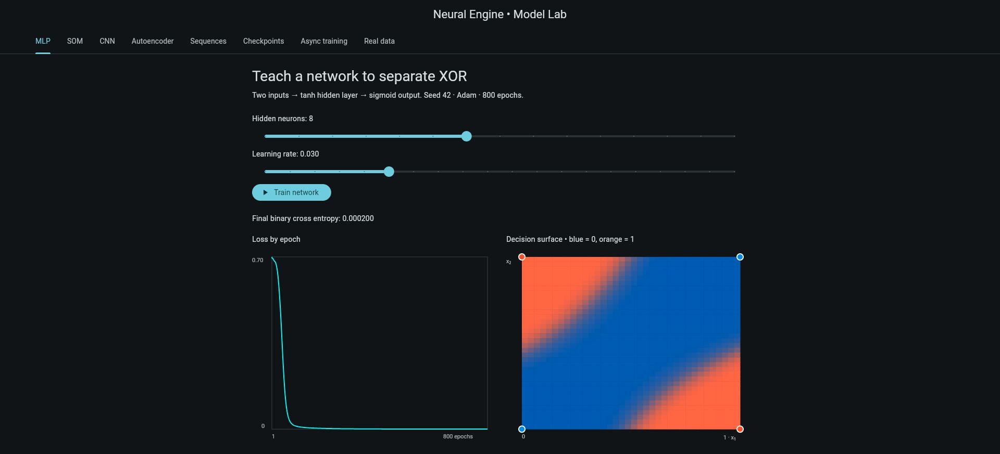
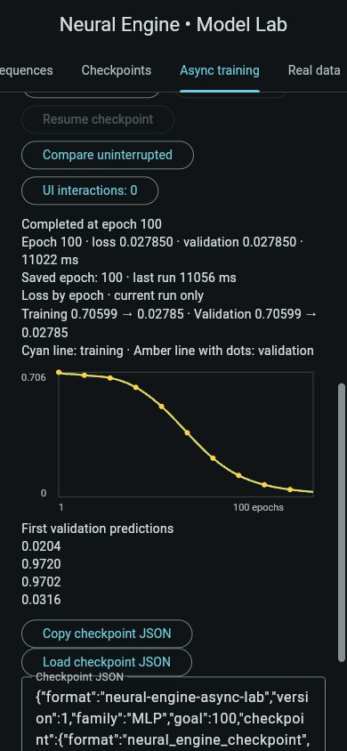
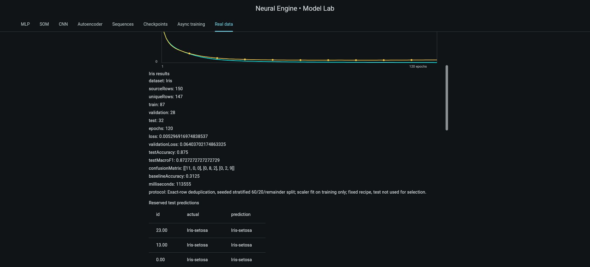

# Laboratory validation — 17 November 2026

## Scope and toolchain

The initial checkout was clean at `179f81b` on `main`, with origin
`https://github.com/kleberandrade/neural-engine.git`. Eight model/utility pages
already existed; no supported model was removed. The pure Dart core is unchanged.
Only this repository was edited; steering-engine was read as a hosting reference.
Flutter was copied to an isolated temporary directory, leaving the shared SDK untouched.

Validated locally with **Flutter 3.50.0, Dart 3.14.0**, macOS arm64 and Chrome.
The Flutter CI job pins 3.50.0. The core keeps Dart >=3.3.0, tested separately by
the CI matrix. Root `dart pub upgrade` and `dart pub outdated` reported no outdated
packages (including test 1.33.0 and lints 6.1.0). The lab app lockfile is versioned;
Flutter fixes test_api 0.7.14 and material_color_utilities 0.13.0 below their latest
catalog versions. These SDK constraints are retained without overrides.

## Checks actually performed

- Core `dart analyze --fatal-infos`: passed, no issues.
- Core `dart test`: **132 passed**, including recipe validation for all six async
  families, altered optimizer rejection and recurrent-family mismatch rejection.
- Lab `flutter analyze --fatal-infos`: passed, no issues.
- Lab `flutter test --exclude-tags benchmark`: **13 passed**. Covers model training,
  narrow screens, CNN drawing, checkpoint recreation, load/resume/exact comparison,
  safe cancellation, pause/reset, disposal during work, numerical chart semantics
  keyboard pixel toggles and a prolonged pointer tap.
- Native and Chrome `responsiveness_test.dart` + `yield_frequency_test.dart`: **2 passed on each platform**, recording real event-loop/cancellation observations and exact replay across fixed-batch policies. These measurements are descriptive and do not establish FPS or hardware-independent latency limits.
- `dart format --output=none --set-exit-if-changed lib test example benchmark validation`:
  passed after final source edits. `git diff --check`: passed.
- `flutter build web --release --no-web-resources-cdn --base-href /neural-engine/`:
  passed. Flutter also completed its Wasm dry run; no separate Wasm deployment is claimed.

The new pause and mismatched-family interaction checks were observed failing
before implementation. Visual inspection revealed a zero-width custom chart in a
Column on mobile. A size assertion reproduced the failure (actual width 0); the
chart now fills the available width, and both the assertion and browser inspection
pass. A prolonged pointer tap also reproduced a parent/child gesture conflict;
starting painting on pan instead of tap-down prevents a pixel from being toggled
twice, while preserving drag painting. The interaction test now covers this case.
Crapper, dryer and mutator were invoked for the changed Dart UI: the installed
tools do not support Dart and reported no source files. No CRAP, duplication or
mutation score is claimed.

## Browser observations and real captures

A local release build was served at the same `/neural-engine/` prefix used by
Pages. Browser accessibility was enabled and its tree inspected. Desktop and
390×844 layouts were exercised, including horizontal tab navigation, vertical
scrolling, readable recipe cards, wrapped controls and full-width curves.

XOR reached binary cross entropy **0.000200** in the standalone 800-epoch recipe.
An async CNN accepted an interaction while training, paused at epoch 46, retained
its checkpoint and resumed to epoch 100 (training loss 0.000233; validation
0.000204). These values describe that deterministic browser run, not performance
or generalization guarantees. A fresh 100-epoch MLP run produced matching
training/reused-validation losses of 0.027850, shown on the mobile capture.

Iris completed 120 epochs in the browser with training/validation/test counts
87/28/32, test accuracy **0.875**, macro F1 **0.872727** and majority-baseline
accuracy **0.3125**. Its training and validation losses were 0.005297 and
0.064037. These results use the fixed split described in the UI.

The cover SVG is an original conceptual diagram, not a screenshot. Screenshot
files are actual browser captures. A complete screen-reader product audit and
mobile-device hardware testing were not performed.

## Delivery log

1. Read root instructions, modernization standard and ub-mode; inspected git,
   manifests, workflows, architecture, runners, tests and existing tutorials.
2. Verified no other active chat was editing neural-engine and isolated the SDK.
3. Preserved all pages; added explicit recipes, live train/validation curves,
   pause/reset, strict checkpoint import, held-out CNN accuracy and keyboard pixels.
4. Tested behavior and fixed the chart width found during visual inspection.
5. Added an English scenario guide ending in five practical exercises, preserved
   Portuguese material, refreshed web metadata and created an original cover.
6. Prepared GitHub Actions static hosting with the correct base path. Deployment
   waits for Dart, Flutter and hosted-consumer checks; pull requests cannot deploy.

No pub.dev release, version tag, paid service, newsletter or external message was
created. No Medium lesson URL/editor was supplied in this task; no Medium
publication or editorial verification is claimed.
