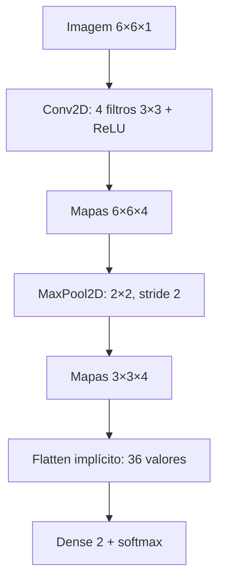

# Guia prático dos modelos neurais

Este guia acompanha código executável. Comece pelos exemplos pequenos, veja o
laboratório Flutter e só depois substitua os dados sintéticos por dados reais.
O objetivo é entender o que cada modelo aprende, como representar os dados e
como verificar o resultado.

[English](models.md) · [Arquitetura e contratos](architecture.md) · [Galeria Flutter](../example/flutter_lab/README.md)

## 1. Qual modelo escolher?

| Modelo | O que recebe no treinamento | O que aprende | Exemplo |
| --- | --- | --- | --- |
| MLP | Vetores e saídas esperadas | Relação entre atributos e alvos | XOR, regressão, classes |
| SOM de Kohonen | Vetores sem rótulos | Protótipos organizados em uma grade | Cores RGB próximas no mapa |
| CNN | Imagens e saídas esperadas | Filtros espaciais e uma decisão | Barras verticais/horizontais |
| Autoencoder denso | Entrada e sua reconstrução desejada | Codificação e reconstrução | Remover ruído de padrões |

SOM não usa backpropagation, SGD ou Adam. Seu neurônio vencedor e os vizinhos
atualizam os protótipos diretamente. CNN e MLP usam gradientes. O autoencoder
apresentado aqui é uma arquitetura montada com a MLP já existente, não uma nova
classe com aprendizado diferente.

Todos os exemplos usam dados gerados localmente, sem downloads, câmera, serviços
externos ou datasets de terceiros. Os geradores compartilhados ficam em
`example/flutter_lab/lib/datasets.dart`; esse arquivo é Dart puro.

## 2. MLP: aprender uma relação entre vetores

Imagine duas entradas que representam interruptores. No XOR, a saída é 1 quando
apenas um está ligado. Uma fronteira linear não separa os quatro casos; uma
camada escondida com ativação não linear permite representar essa relação.

```dart
final network = NeuralNetwork(
  inputSize: 2,
  layers: [
    Dense(8, activation: Activation.tanh),
    Dense(1, activation: Activation.sigmoid),
  ],
  seed: 42,
);
final history = network.fit(
  inputs: [[0, 0], [0, 1], [1, 0], [1, 1]],
  targets: [[0], [1], [1], [0]],
  loss: const BinaryCrossEntropy(),
  optimizer: Adam(learningRate: 0.03),
  epochs: 1200,
  batchSize: 4,
);
print(network.predict([0, 1]));
```

Importe `package:neural_engine/neural_engine.dart` nos trechos deste guia. Os
exemplos completos incluem `main()` e verificações de convergência:

```sh
dart run example/neural_engine_example.dart
dart run example/regression.dart
dart run example/classification.dart
```

`inputSize` conta atributos, não amostras. Cada lista interna é uma amostra.
`Dense(8)` produz oito valores; `Dense(1)` produz um. BCE combina com sigmoid;
softmax e CCE combinam com classes exclusivas; saída linear e MSE são uma escolha
para regressão. Uma época percorre todo o treino e um mini-batch produz uma
atualização. A perda registrada é medida após cada época completa.

**Experimente:** troque a camada escondida por uma saída linear e compare o
resultado. Depois varie neurônios e taxa de aprendizado na aba MLP. Compare
perda e fronteira de decisão, não apenas uma previsão.

## 3. SOM: organizar cores sem ensinar classes

Uma cor é o vetor `[r, g, b]`, com canais entre 0 e 1. O SOM tem uma grade de
neurônios; cada célula guarda um vetor RGB chamado protótipo. Para cada amostra:

1. Encontra o protótipo de menor distância euclidiana: o BMU.
2. Aproxima o BMU e seus vizinhos da cor observada.
3. Reduz gradualmente taxa e raio da vizinhança.

A atualização é `w ← (1 − αh)w + αhx`, onde `h` é a influência gaussiana baseada
na distância entre células da grade. Células próximas ao BMU recebem influência
maior. A grade é retangular, sem conexão entre bordas opostas.

```dart
final map = SelfOrganizingMap(
  rows: 6,
  columns: 6,
  inputSize: 3,
  seed: 42,
);
final history = map.fit(
  colors, // List<List<double>>, RGB normalizado
  epochs: 80,
  radius: 3,
  finalRadius: 0.4,
);
final match = map.winner([1, 0, 0]);
print('Vermelho: linha ${match.row}, coluna ${match.column}');
print(history.quantizationErrors.last);
```

`colors` é gerado no exemplo completo:

```sh
dart run example/som_colors.dart
```

O erro de quantização é a média das distâncias euclidianas até o BMU, sem elevar
a distância ao quadrado no resultado final. Quanto menor, melhor a aproximação
aos dados; isso não garante por si só a qualidade da organização topológica.
O erro não precisa cair em todas as épocas. Coordenadas do mapa não são rótulos:
a célula `(0, 0)` não significa automaticamente "vermelho". Uma organização
espelhada ou girada também pode ser válida.

**Observe no Flutter:** compare as grades antes e depois e passe sobre as células
para inspecionar RGB. **Experimente no Dart:** grade 3×3 versus 8×8, raio inicial
pequeno versus grande. Normalize atributos de naturezas diferentes para evitar
que um atributo de maior escala domine a distância. Pesos iniciais são uniformes
em `[0, 1]`; a escala dos dados deve ser compatível.

## 4. CNN: reconhecer padrões espaciais

Uma CNN aplica o mesmo filtro em diferentes posições. Em vez de aprender um peso
independente para cada posição, compartilha os pesos do kernel. O exemplo separa
barras verticais de horizontais em imagens 6×6 em tons de cinza.



```dart
final model = ConvolutionalNetwork(
  inputHeight: 6,
  inputWidth: 6,
  inputChannels: 1,
  layers: [
    Conv2D(
      filters: 4,
      kernelSize: 3,
      padding: ConvolutionPadding.same,
    ),
    MaxPool2D(),
  ],
  denseLayers: [Dense(2, activation: Activation.softmax)],
  seed: 42,
);
final history = model.fit(
  inputs: trainingImages,
  targets: trainingLabels,
  loss: const CategoricalCrossEntropy(),
  optimizer: Adam(learningRate: 0.02),
  epochs: 100,
  batchSize: 8,
);
```

`trainingImages` e `trainingLabels` estão no programa completo:

```sh
dart run example/cnn_bars.dart
```

### Como representar uma imagem

`ImageTensor` é imutável, com altura, largura e canais positivos. `values` usa
ordem **HWC**: percorra linha, coluna e, por último, canal. Em RGB, os três canais
de um pixel vêm juntos. O índice é `(linha * largura + coluna) * canais + canal`.

```dart
final image = ImageTensor(
  height: 2, width: 2, channels: 1,
  values: [1, 0, 0, 1], // diagonal: primeiro pixel e último pixel acesos
);
print(image.at(1, 1, 0)); // 1.0
```

`same` usa zeros nas bordas e produz dimensão `ceil(entrada / stride)`; não
significa manter dimensões quando stride é maior que 1. Em padding ímpar, o
excedente fica embaixo/à direita. `valid` não adiciona bordas. Max pooling é
`valid` e age por canal. Em empates, o gradiente vai para a primeira posição.
Conv2D usa correlação cruzada, a convenção comum em CNNs: o kernel não é invertido.

`featureMaps(image)` retorna os tensores após cada camada espacial. No Flutter,
selecione uma imagem e um canal para ver a ativação do filtro. A visualização
normaliza o contraste por canal: brilhos não são comparáveis entre canais.
Os mapas são respostas aprendidas; não há garantia de que cada canal represente
um detector de bordas interpretável.

Os rótulos são `[1, 0]` para vertical e `[0, 1]` para horizontal. O treino e o
teste usam seeds de ruído diferentes, mas as mesmas posições de barra. Acertar
esse teste não demonstra generalização para fotos, rotações ou posições novas.

**Experimente:** remova o pooling, varie os filtros e tente outra intensidade
de ruído. Compare a perda e a acurácia no conjunto separado. Pooling perde posição
fina; mais filtros aumentam parâmetros e custo. Não mude rótulos para compensar
uma previsão errada sem entender o dataset.

Nesta implementação, o treinamento é ponta a ponta: o gradiente atravessa a
camada densa, o flatten, o pooling e os kernels. O treinador CNN inicial oferece
mini-batches e perda por época. Validação com early stopping ainda é exclusiva
do treinador MLP; avalie a CNN com `evaluate` em conjuntos separados.

## 5. Autoencoder: aprender a reconstruir

No autoencoder, o alvo pode ser a própria entrada. No exemplo de remoção de
ruído, o alvo é o padrão limpo correspondente. A arquitetura comprime oito
valores em duas coordenadas latentes e reconstrói oito valores.

```dart
final model = NeuralNetwork(inputSize: 8, seed: 42, layers: [
  Dense(6, activation: Activation.tanh),
  Dense(2, activation: Activation.tanh), // gargalo: código latente
  Dense(6, activation: Activation.tanh),
  Dense(8, activation: Activation.sigmoid),
]);
final history = model.fit(
  inputs: noisyPatterns,
  targets: cleanPatterns,
  loss: const BinaryCrossEntropy(),
  optimizer: Adam(learningRate: 0.02),
  epochs: 400,
  batchSize: 8,
);
final code = model.layerOutputs(noisyPatterns.first)[1];
final reconstruction = model.predict(noisyPatterns.first);
```

Os dados e a avaliação estão em:

```sh
dart run example/autoencoder.dart
```

Os padrões têm valores entre 0 e 1. Sigmoid/BCE combina com essa representação;
MSE mede o erro de reconstrução no teste. A aba Flutter mostra entrada ruidosa,
alvo limpo, reconstrução e código latente. Os pesos do encoder e do decoder são
independentes, não amarrados. `layerOutputs` retorna snapshots, não referências
mutáveis aos estados internos.

O conjunto tem quatro padrões conhecidos com novas realizações de ruído no
teste. Reconstruir bem esses padrões não torna o modelo um detector de fraude,
um compressor de imagens ou um detector de anomalias validado.

**Experimente:** aumente o ruído ou reduza o gargalo para um neurônio. Observe o
erro em dados separados, não apenas a qualidade da reconstrução de treino.

## 6. Salvar, avaliar e reproduzir

MLP, SOM e CNN têm `toJson()` e seus próprios construtores `fromJson`. Use o
construtor da família correta. Autoencoders densos usam o formato da MLP. Os
formatos são versionados e validam dimensões, valores finitos e arquitetura.
Não salvam momentos de Adam nem progresso de treinamento.

```dart
// Acrescente import 'dart:convert';
final encoded = jsonEncode(model.toJson());
final restored = ConvolutionalNetwork.fromJson(
  jsonDecode(encoded) as Map<String, dynamic>,
);
```

No trecho acima, `model` é uma CNN treinada. Para SOM use
`SelfOrganizingMap.fromJson`; para MLP/autoencoder use `NeuralNetwork.fromJson`.
IO fica a cargo da aplicação. Cada nova chamada a `fit` mantém pesos atuais,
reinicia o estado do otimizador e recomeça a sequência de embaralhamento da seed.
SOM também reinicia seu cronograma de taxa/raio por chamada.

Normalize usando estatísticas do treino e reutilize-as no teste. Não ajuste
hiperparâmetros consultando repetidamente o conjunto final de teste. Seeds ajudam
na repetição no mesmo SDK/plataforma; igualdade bit a bit entre todas as
plataformas não é garantida.

## 7. O que existe e o que vem depois

| Família | Estado |
| --- | --- |
| MLP e autoencoder denso | Implementados; exemplos Dart e Flutter |
| SOM retangular de Kohonen | Implementado; exemplos Dart e Flutter |
| CNN 2D com max pooling | Implementada; exemplos Dart e Flutter |
| RNN, LSTM e GRU | Planejados, ainda sem implementação |
| Hopfield, RBF e outros modelos clássicos | Candidatos para etapas posteriores |
| Transformers, GPU e importação ONNX | Fora do escopo desta etapa |

Antes de acrescentar uma família, exigir API clara, testes numéricos aplicáveis,
exemplo Dart, demonstração Flutter e tutorial com limites. O núcleo permanece
Dart puro. Não há integração com outro engine nesta etapa.
