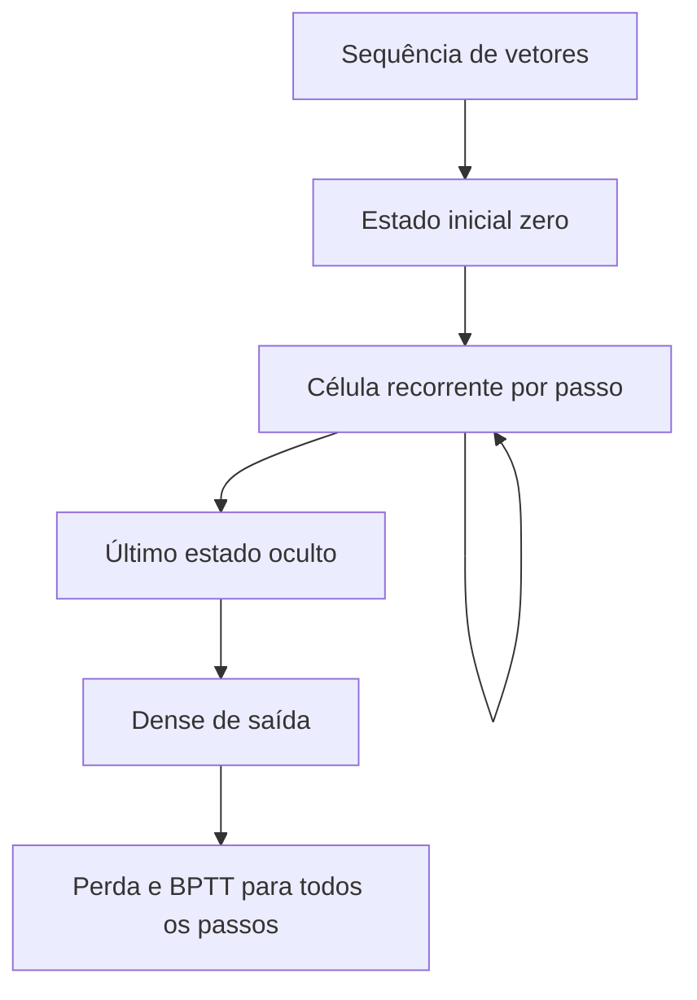

# RNN, LSTM e GRU: previsão de sequências

[English](recurrent.md) · [Diagramas](architecture/class_diagrams.md) · [Estrutura](architecture/structure.md)

Uma MLP recebe um vetor. Aqui, a entrada recorrente é uma sequência de vetores:
`[amostra][tempo][atributo]`. Um estado oculto combina a observação atual com o
passado. O modelo implementado é **muitos para um**: lê toda a sequência e aplica
uma camada densa ao último estado para produzir o alvo.

## Mesmo problema para os três modelos

O programa gera 24 fases de uma senoide. Cada entrada contém seis valores,
separados por 0,25 radianos, e o alvo é o sétimo. O teste intercala fases entre
as usadas no treino. Não são novas famílias de sinal nem séries financeiras.

```sh
dart run example/recurrent_sequences.dart
```

```dart
final model = RecurrentNetwork(
  inputSize: 1, hiddenSize: 6, outputSize: 1,
  kind: RecurrentKind.lstm,
  outputActivation: Activation.linear,
  seed: 42,
);
final history = model.fit(
  inputs: trainingSequences, targets: trainingTargets,
  loss: const MeanSquaredError(),
  optimizer: Adam(learningRate: 0.015),
  epochs: 180, batchSize: 8, maxGradientNorm: 1,
);
final prediction = model.predict([[0.0], [0.2], [0.4], [0.6], [0.8], [1.0]]);
final states = model.trace([[0.0], [0.2], [0.4]]);
```

As listas de treino estão no exemplo completo. Troque `kind` por `.rnn` e `.gru`
para comparar. A previsão do trecho é uma inferência sobre a entrada indicada,
não um valor garantido: esses seis números não seguem exatamente o treino.

## O que muda em cada célula?

| Célula | Estado | Transição | Característica |
| --- | --- | --- | --- |
| RNN simples | h | `h = tanh(Wx + Uh_anterior + b)` | Toda memória passa pela mesma transformação |
| LSTM | h e c | `c = f*c_anterior + i*g`; `h = o*tanh(c)` | Portas de entrada, esquecimento e saída regulam memória separada |
| GRU | h | `n = tanh(Wx + U(r*h_anterior) + b)`; `h = (1-z)*n + z*h_anterior` | Reset e atualização controlam a mistura do estado |

Na LSTM, i/f/o são sigmoids e g é tanh. A implementação não usa peepholes. A GRU
usa **reset-before**: o reset multiplica o estado antes da matriz recorrente.
Pesos de uma implementação reset-after não podem ser importados diretamente.
Mais portas implicam mais parâmetros; seis unidades em cada modelo não significam
mesmo custo ou capacidade. O exemplo informa os parâmetros e as métricas.



## Treinamento e estado

O gradiente da saída percorre todos os passos, acumulando contribuições sobre
os mesmos pesos da célula. Isso é retropropagação no tempo, ou BPTT. Os testes
comparam cada parâmetro contra diferenças finitas em sequências de vários passos.
`maxGradientNorm` limita a norma L2 do gradiente médio do mini-batch; não altera
a perda e não é uma prova de estabilidade em qualquer problema.

Cada chamada de previsão começa com h/c zero. Não existe estado oculto global
entre solicitações. `trace` retorna snapshots imutáveis dos estados, permitindo
inspecionar a memória sem modificá-la. Os objetos `RecurrentStep`/`CellCache`
pertencem a uma execução, enquanto a célula guarda apenas os pesos.

O treinador compartilhado também aceita validação, patience e minDelta. Use um
conjunto de validação independente para escolher a parada, preservando o teste
para a avaliação final. O JSON guarda pesos/arquitetura, não estado de sequência
nem momentos de Adam.

## Laboratório Flutter

Na aba **Sequences**, execute a comparação e escolha RNN, LSTM ou GRU. Observe:

1. MSE do treino por época e erro de teste na tabela.
2. Entrada, próximo alvo e previsão para uma amostra separada.
3. Estado oculto por passo/unidade; na LSTM, memória c separadamente.

As cores usam contraste por mapa; tooltips mostram números reais. Tempo medido
na interface varia com dispositivo, JIT e plataforma. Não use uma única execução
para declarar uma arquitetura universalmente melhor.

**Experimentos:** varie o tamanho da janela, os neurônios e a frequência do sinal;
compare a extrapolação para uma frequência não treinada; só depois introduza
séries reais, normalização e particionamento temporal sem vazamento.

Limites atuais: saída apenas no último passo, sem empilhamento/bidirecionalidade,
sem máscaras/padding, sem truncated BPTT, dropout recorrente ou GPU. Sequências
podem ter comprimentos diferentes, mas precisam de ao menos um vetor válido.
O consumo de memória cresce com a quantidade de passos.
