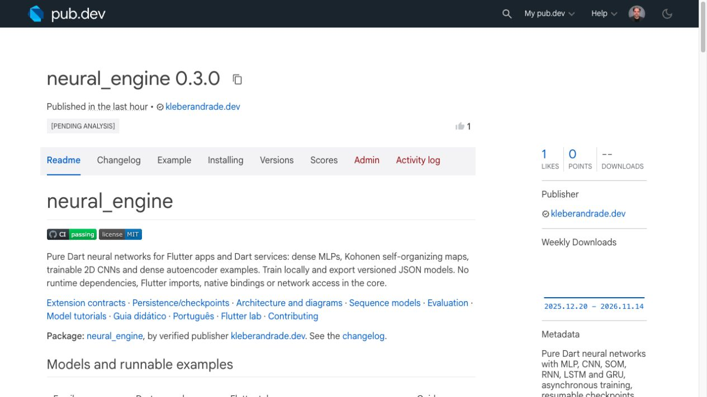

# 0.3.0 release scope

The release combines portable asynchronous training with repeatable evaluation:

- Native isolate worker and cooperative browser batches sharing synchronous math.
- Epoch progress, optional validation metrics, safe cancellation and v1 checkpoint
  continuation for MLP/CNN/RNN/LSTM/GRU; dense autoencoders use the MLP path.
- Flutter Async training and Real data tabs, independent CLI examples and bilingual
  lifecycle/architecture/real-data documentation.
- Offline, attributed Iris and AirPassengers snapshots, training-only scalers,
  explicit reserved partitions and baselines, including the GRU's weaker result.
- Responsiveness probes for Dart and Flutter native/Chrome hosts, full machine-readable
  reports and limits distinguishing event-loop delays, frame times and memory metrics.
- [Evidence-led 0.4.0 plan](roadmap_0.4.0.md).

Local verification: 98 Dart tests; analyzer; all-family native/JavaScript replay;
real-data examples on native/JavaScript; dataset equality/hash checks; generated API
reference without warnings. Full Flutter tests, Chrome measurements, web build and
package publication validation run in CI.

The complete [source CI](https://github.com/kleberandrade/neural-engine/actions/runs/43960668085)
passed with 98 Dart tests, nine Flutter widget tests, both measured Flutter hosts,
minimum/stable Dart, hosted 0.2.1 regression validation, JavaScript examples, web
build and package dry-run. See the permanent native/Chrome snapshots in
`doc/benchmarks/`.

## Publication

Published November 16, 2026 under verified publisher `kleberandrade.dev`.

- [Exact artifact](https://pub.dev/packages/neural_engine/versions/0.3.0)
- [GitHub release / immutable tag](https://github.com/kleberandrade/neural-engine/releases/tag/v0.3.0)
- [Source CI at release commit](https://github.com/kleberandrade/neural-engine/actions/runs/43962776920)
- [Successful publication workflow](https://github.com/kleberandrade/neural-engine/actions/runs/43963176486)
- Release commit: `27d56cf4fe316163459519a0f8240b3716f9bec8`.

The independent `validation/hosted/` consumer now pins exactly 0.3.0 and requires
both a hosted lockfile source and the exact hosted package-config root. Its CI
matrix runs Dart 3.3.4/stable and checks all inference codecs/scalers plus five
supervised families × Adam/SGD × automatic/cooperative execution, streamed
validation progress, cancellation, disk JSON and exact synchronous replay.
This post-publication verification does not modify the tagged artifact.

