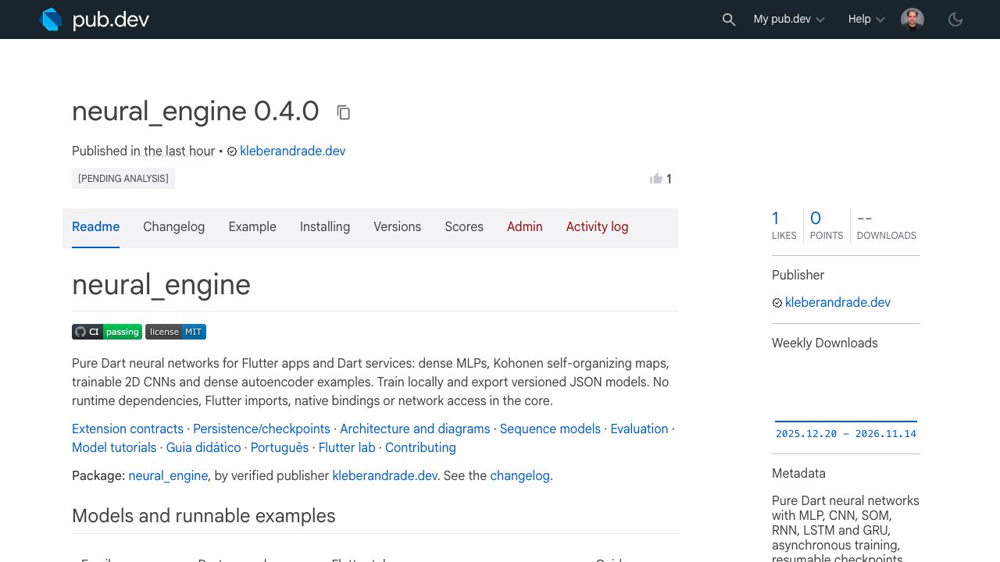

# 0.4.0 release scope

- Incremental preflight, training and validation evaluation, with original
  per-sample sum order, one final division and stable fused BCE/CCE losses.
- Optional SampleLossModel contract: external reductions remain atomic unless
  explicitly opted in; existing DifferentiableModel and v1 checkpoints remain.
- Typed trainer events, separate evaluation progress and configurable evaluation
  blocks, pause frequency and optional between-unit work-duration budget.
- Flutter controls, native/isolate and cooperative cancellation/replay coverage.
- Fixed-batch yield matrices, VM allocation counters/stacks and actual Linux and
  Chrome release-build frame probes with explicit measurement limits.
- Validation-only four-candidate forecasting experiment, preserving the published
  test; selected GRU still trails seasonal validation baselines.

[Implementation CI](https://github.com/kleberandrade/neural-engine/actions/runs/43975841654)
passed 125 Dart tests, minimum/stable SDKs, extension/hosted consumers, JavaScript
examples, Flutter tests, native/Chrome measurements, web build and package dry run.
[Performance evidence](https://github.com/kleberandrade/neural-engine/actions/runs/43975841544)
passed baseline/current allocation collection and release-frame capture with
per-platform checkpoint equality. See [permanent observations](benchmarks/scheduling_0.4.0.md).

The goal is scheduling control and evaluation responsiveness. The allocation
sample shows additional executor cost; no throughput improvement, optimizer
buffer optimization, worker pool or physical-phone frame guarantee is claimed.
The optional duration cannot interrupt one indivisible sample/batch operation.

## Publication

Published November 16, 2026 under verified publisher `kleberandrade.dev`.

- [Exact hosted artifact](https://pub.dev/packages/neural_engine/versions/0.4.0)
- [GitHub release](https://github.com/kleberandrade/neural-engine/releases/tag/v0.4.0)
- [Final source CI](https://github.com/kleberandrade/neural-engine/actions/runs/43976742408)
- [Successful OIDC publication](https://github.com/kleberandrade/neural-engine/actions/runs/43977287304)
- Immutable release commit: `22ef1294a14366f5ade2f3c37886a00fcca5026c`.

The independent consumer now pins exactly 0.4.0 and checks its hosted lockfile and
package root. It verifies all inference/scaler codecs, disk JSON, Adam/SGD,
automatic/cooperative execution, epoch/evaluation streams, explicit scheduling,
cancellation and exact checkpoint replay across five supervised model families.
The post-publication consumer matrix must pass on minimum/stable SDKs; it never
uses a path override or changes the tagged artifact.

